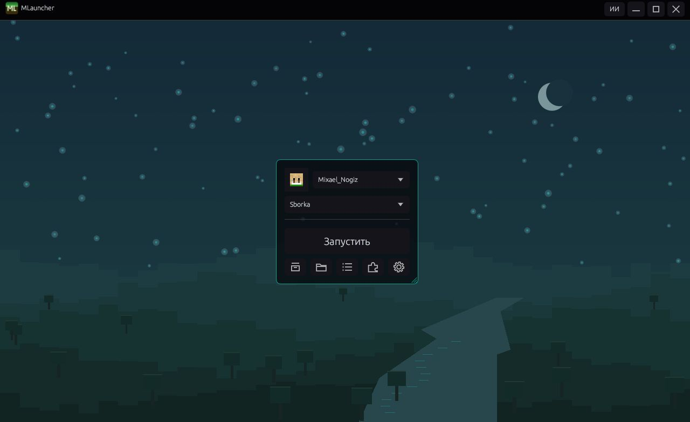
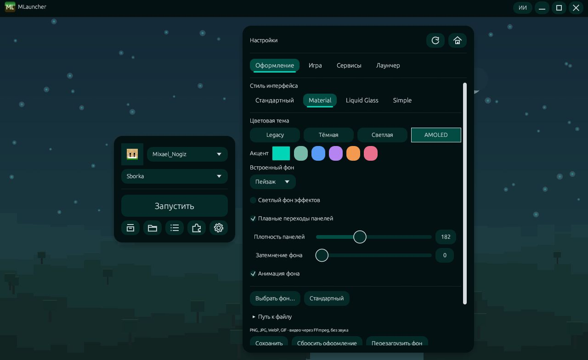
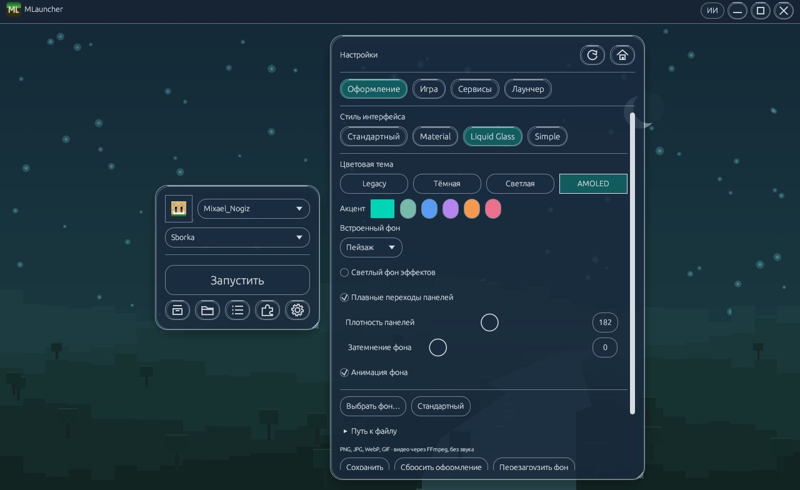
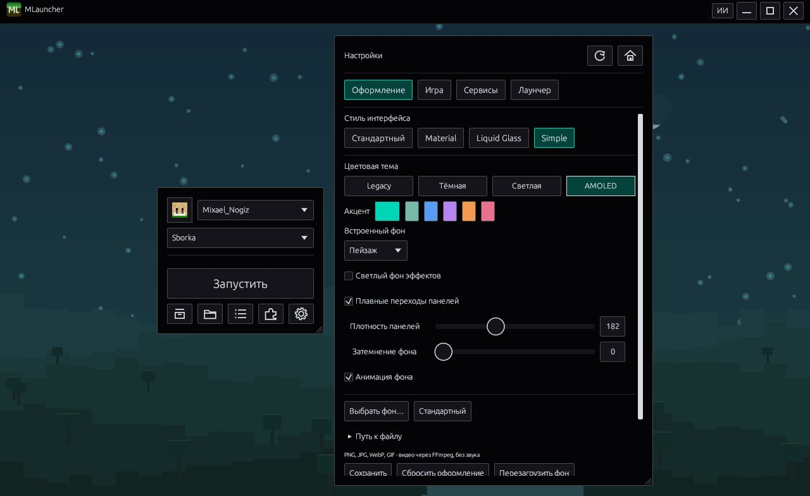
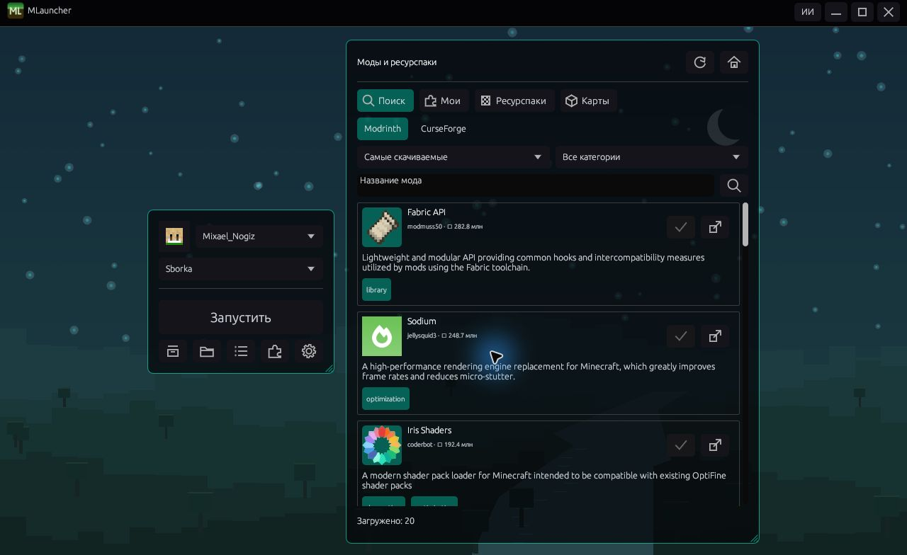
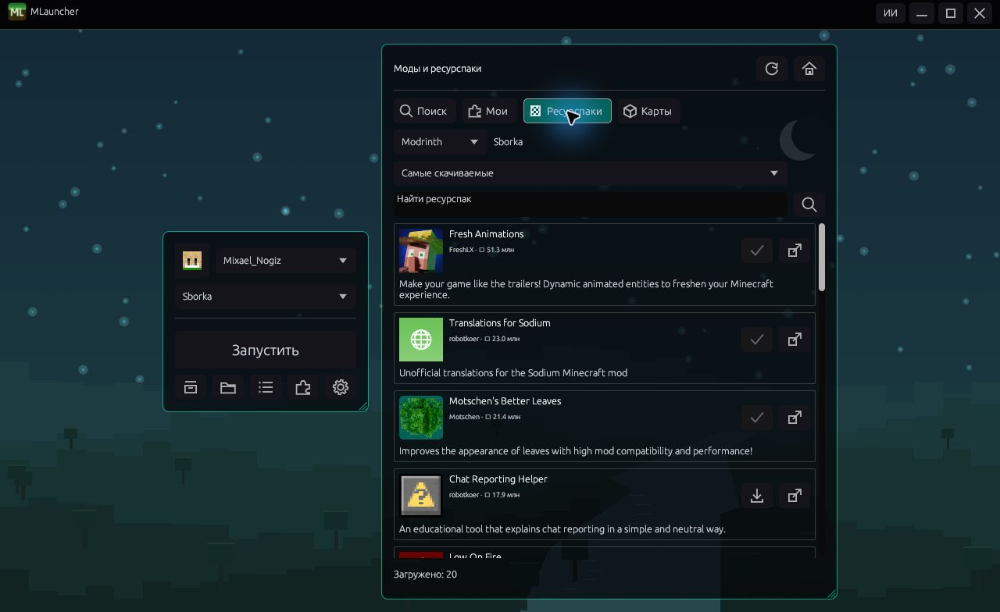
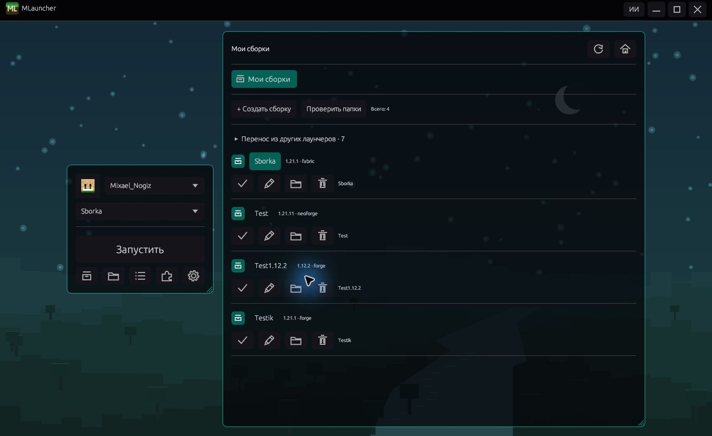
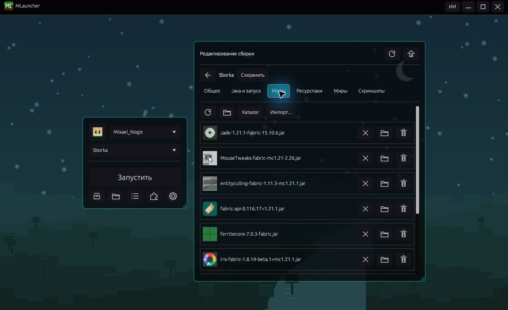

# MLauncher

Лаунчер Minecraft Java Edition для Windows x64. Устанавливайте игру и моды, управляйте сборками, мирами и скриншотами из одного окна.

[Скачать последнюю версию](https://github.com/MixiYT/MLauncher/releases/latest) · [Все релизы](https://github.com/MixiYT/MLauncher/releases)

## Как начать

1. Скачайте ZIP полной или Lite-версии и распакуйте его в отдельную папку.
2. Запустите MLauncher.exe или MLauncher-Lite.exe.
3. Добавьте аккаунт, выберите версию Minecraft и загрузчик.
4. Нажмите «Запустить». Нужная Java и игровые файлы загрузятся автоматически.

Поддерживаются Microsoft, Ely.by и локальные аккаунты. Для Microsoft Java Edition нужна лицензия игры.

## Возможности

- Minecraft Vanilla, Fabric, Quilt, Forge и NeoForge.
- Поиск и установка модов, ресурспаков, карт и готовых сборок.
- «Мои сборки» с отдельными настройками Java и памяти.
- Редактор модов, миров и скриншотов каждой сборки.
- Поиск сборок Prism, ElyPrism, MultiMC, Minecraft, TLauncher и Legacy и копирование их в MLauncher.
- Автоматическое скачивание и установка обновлений лаунчера.
- Настройка поведения после запуска игры, включая сворачивание в трей и возврат после закрытия Minecraft.
- Светлая, тёмная и AMOLED-темы, свои фоны и стили Material, Liquid Glass и Simple.

## ИИ-помощник

Нажмите «ИИ» в верхней части окна. Помощник умеет собирать модифицированные сборки по описанию, запускать их и исправлять ошибки запуска.

Например, напишите «Создай Fabric 1.21.1 с Sodium, Iris и Jade и запусти» и нажмите «Выполнить запрос».
Для уже установленной сборки используйте «Исправить текущую сборку».

Настройте адрес API, модель и ключ в «Настройки → Сервисы». Запрос, параметры сборки и очищенные журналы отправляются выбранному вами сервису.
В помощнике можно включить автоисправление и задать от одной до трёх попыток. Изменения модов сопровождаются резервной копией, доступен откат последнего исправления.
Во время автоматического запуска лаунчер остаётся открытым. Успешное исправление зависит от причины ошибки и наличия совместимых модов.

## Полная и Lite-версии

Полная версия включает внутриигровой оверлей Shift+Tab, мультисессии и дополнительные эффекты фона.
Lite использует простые эффекты и поддерживает изображения и GIF. Управление сборками, ИИ-помощник и три стиля интерфейса доступны в обеих редакциях.

## Интерфейс

| Material | Liquid Glass | Simple |
| --- | --- | --- |
|  |  |  |

Снимки показывают интерфейс версии 0.3.11.

Моды, ресурспаки и редактор сборок

## Если возникла проблема

Обновите лаунчер и посмотрите «Журнал запуска». Его можно передать ИИ-помощнику для разбора.
Перед переносом сборки закройте её в исходном лаунчере.
Освободить кеш можно через «Настройки → Лаунчер → Кеш лаунчера».

[Техническая документация, сборка из исходников и подробности совместимости](docs/TECHNICAL.md) · [Лицензия MIT](LICENSE)
